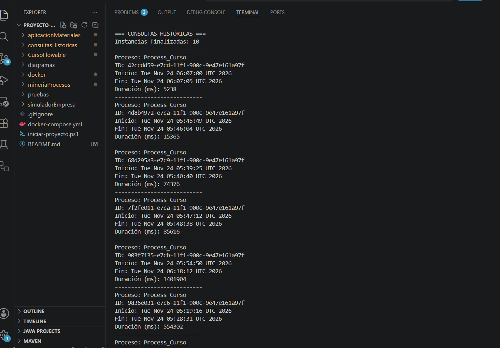
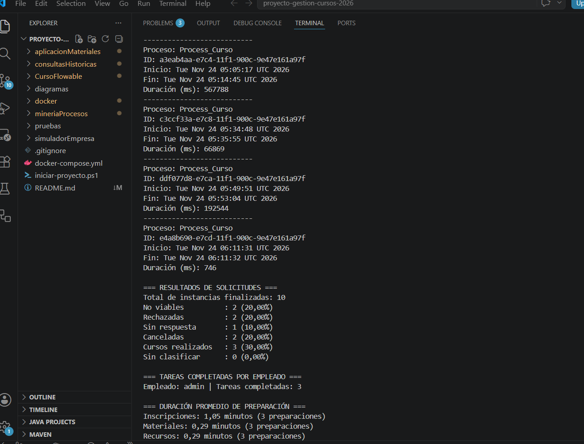
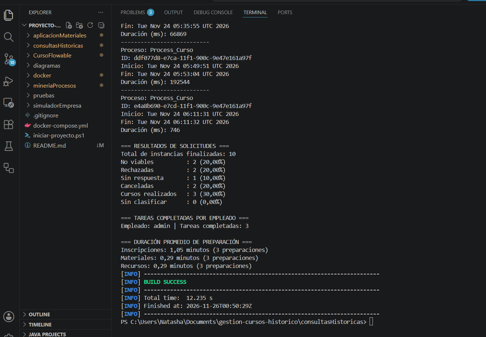

# Consultas históricas y análisis de resultados

## 1. Objetivo

El módulo de consultas históricas del proyecto de gestión de cursos de capacitación permite recuperar información de las instancias finalizadas del proceso, analizar los resultados de las solicitudes, contabilizar las tareas completadas por empleado y calcular la duración promedio de las ramas paralelas de preparación de los cursos.

## 2. Implementación

El módulo `consultasHistoricas` está desarrollado en Java y utiliza la API de Flowable para consultar el historial almacenado en PostgreSQL, sin necesidad de iniciar nuevas instancias del proceso.

- `App.java`: punto de entrada de la aplicación y presentación de los resultados por consola.
- `FlowableHistoryService.java`: configuración de la conexión al motor Flowable y acceso al historial.
- `ConsultasHistoricas.java`: procesamiento de la información histórica y cálculo de indicadores.

La ejecución recuperó diez instancias finalizadas del proceso `Process_Curso`, incluyendo sus identificadores, fechas de inicio y finalización y duración en milisegundos.

## 3. Distribución de resultados de las solicitudes

Resultados recuperados de una corrida de diez instancias finalizadas:

| Resultado | Cantidad | Porcentaje |
|---|---:|---:|
| No viables | 2 | 20 % |
| Rechazadas | 2 | 20 % |
| Sin respuesta | 1 | 10 % |
| Canceladas | 2 | 20 % |
| Cursos realizados | 3 | 30 % |
| Sin clasificar | 0 | 0 % |
| **Total** | **10** | **100 %** |

El porcentaje se calcula dividiendo la cantidad de instancias de cada categoría por el total de instancias finalizadas y multiplicando por 100.

## 4. Tareas completadas por empleado

| Empleado | Tareas completadas |
|---|---:|
| admin | 3 |

La consulta devuelve la cantidad de tareas completadas agrupadas por empleado. En la ejecución se contabilizaron tres tareas asociadas al usuario `admin`.

Este indicador permite analizar la distribución del trabajo entre empleados. Sin embargo, con la salida obtenida no es posible confirmar si las tres tareas representan la totalidad de las tareas que deberían contabilizarse.

## 5. Duración promedio de las ramas paralelas de preparación

| Rama | Duración promedio (minutos) | Preparaciones contabilizadas |
|---|---:|---:|
| Inscripciones | 1,05 | 3 |
| Materiales | 0,29 | 3 |
| Recursos | 0,29 | 3 |

La rama de inscripciones fue la de mayor duración promedio.
Como las ramas se ejecutan en paralelo, sus duraciones no deben sumarse para obtener la duración total de la preparación. La rama que termina última condiciona la sincronización de las actividades paralelas en cada instancia. Los promedios sugieren que inscripciones es una rama de interés para estudiar posibles demoras, aunque no demuestran que haya sido la última en finalizar en cada caso.

Las duraciones corresponden a ejecuciones de prueba, no a tiempos operativos reales de una institución.

## 6. Instrucciones de ejecución

Con PostgreSQL disponible y las credenciales de conexión correctamente configuradas, ejecutar desde la raíz del proyecto:

```powershell
cd consultasHistoricas
mvn compile exec:java "-Dexec.mainClass=historico.App"
```

La aplicación muestra por consola las instancias finalizadas y los tres indicadores analizados.

## 7. Conclusión

La prueba permitió recuperar información histórica persistida en Flowable y generar indicadores sobre los resultados de las solicitudes, las tareas realizadas y los tiempos de preparación. Se verificó la ejecución del módulo, la clasificación de las diez instancias y la obtención de los promedios de las tres ramas paralelas. Queda pendiente la comprobación exhaustiva del conteo de tareas por empleado.

# 8. Consola

<p align="center">
  
  
  
</p>