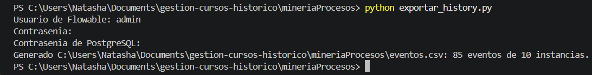
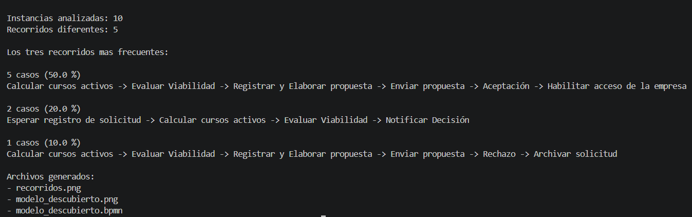
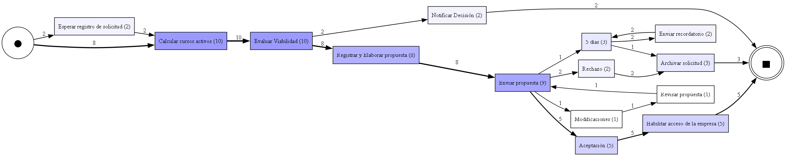
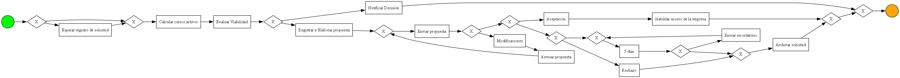

# Minería de procesos – Etapa de negociación

## 1. Objetivos

Realizar un análisis de las ejecuciones de la etapa de negociación del proceso de gestión de cursos, utilizando las actividades históricas registradas en Flowable.

Se busca identificar los recorridos más frecuentes, obtener una representación gráfica del comportamiento observado y comparar los resultados con el modelo BPMN original.

## 2. Herramientas utilizadas

- Flowable 6.8.0.
- PostgreSQL.
- Python.
- PM4Py.
- Graphviz.

## 3. Instrucciones de ejecución

### Requisitos previos

- Tener Python instalado.
- Tener Graphviz instalado y agregado al PATH.
- Tener Flowable y PostgreSQL en ejecución.
- Contar con instancias históricas finalizadas del proceso.

### Preparación del entorno

Desde la raíz del proyecto, ejecutar:

```powershell
python -m venv .venv
```

Activar el entorno virtual:

```powershell
.\.venv\Scripts\Activate.ps1
```

Instalar las dependencias:

```powershell
pip install -r .\mineriaProcesos\requirements.txt
```

### Exportación del historial

Ejecutar:

```powershell
python .\mineriaProcesos\exportar_history.py
```

Ingresar las credenciales de Flowable y PostgreSQL cuando sean solicitadas.

El script genera el archivo `eventos.csv` con las actividades históricas seleccionadas de la etapa de negociación.



### Análisis de los eventos

Ejecutar:

```powershell
python .\mineriaProcesos\analizar.py
```

Este script permite identificar los recorridos más frecuentes y generar las representaciones gráficas del proceso.

## 4. Archivos

Trabajamos sobre dos scripts de Python.
1. exportar_history.py
Es el encargado de recuperar y preparar los datos históricos.

Las adaptaciones que realizamos fueron:
- Obtener las instancias y actividades históricas mediante la API REST de Flowable.
- Filtrar las instancias correspondientes a nuestro proceso Process_Curso.
- Incorporar paginación para recuperar todos los registros.
- Seleccionar las actividades correspondientes a la negociación mediante sus identificadores BPMN.
- Excluir actividades eliminadas, interrumpidas o sin finalizar.
- Consultar PostgreSQL para identificar actividades descartadas.
- Ordenar cronológicamente los eventos.
- Generar el archivo eventos.csv para su posterior análisis.
2. analizar.py
Es el encargado de aplicar las técnicas de minería de procesos utilizando la biblioteca PM4Py.

Lo adaptamos para obtener:
- Cantidad de instancias analizadas.
- Cantidad de recorridos diferentes (variantes).
- Frecuencia y porcentaje de cada recorrido.
- Los tres recorridos más frecuentes.
- Grafo de sucesión directa de actividades (DFG).
- Descubrimiento de un modelo mediante minería inductiva.
- Exportación del modelo descubierto en formato PNG y BPMN.
También incorporamos el archivo requirements.txt con las dependencias necesarias

## 5. Resultados obtenidos

| Indicador | Cantidad |
|---|---:|
| Eventos históricos exportados | 102 |
| Instancias analizadas | 10 |
| Recorridos diferentes | 5 |

### Tres recorridos más frecuentes

#### Recorrido 1 – Aceptación de la propuesta

- Cantidad: 5 instancias.
- Porcentaje: 50 %.

Calcular cursos activos → Evaluar Viabilidad → Registrar y Elaborar propuesta → Enviar propuesta → Aceptación → Habilitar acceso de la empresa.

#### Recorrido 2 – Solicitud no viable

- Cantidad: 2 instancias.
- Porcentaje: 20 %.

Esperar registro de solicitud → Calcular cursos activos → Evaluar Viabilidad → Notificar Decisión.

#### Recorrido 3 – Rechazo de la propuesta

- Cantidad: 1 instancia.
- Porcentaje: 10 %.

Calcular cursos activos → Evaluar Viabilidad → Registrar y Elaborar propuesta → Enviar propuesta → Rechazo → Archivar solicitud.

Los otros dos recorridos identificados también presentan una frecuencia de una instancia cada uno (10 %), por lo que existe un empate en el tercer lugar.



## 6. Representaciones gráficas

### Gráfico de sucesión directa (DFG)

El gráfico representa las actividades observadas, sus frecuencias y las relaciones de sucesión directa entre ellas.



### Modelo BPMN descubierto

Modelo generado automáticamente mediante PM4Py a partir de los eventos históricos.



El modelo también se encuentra disponible en el archivo `modelo_descubierto.bpmn`.

## 7. Comparación con el BPMN original

### Coincidencias

El modelo descubierto representa los principales comportamientos de la etapa de negociación:

- Evaluación de viabilidad de la solicitud.
- Notificación de solicitudes no viables.
- Elaboración y envío de propuestas.
- Aceptación y habilitación del acceso de la empresa.
- Rechazo y archivo de solicitudes.
- Modificación, revisión y reenvío de propuestas.
- Vencimiento del plazo de respuesta.
- Envío de recordatorios.
- Archivo de solicitudes por falta de respuesta.

### Diferencias

- El modelo descubierto no reproduce exactamente los tipos de compuertas del BPMN original.
- No se reconstruyen las condiciones de las reglas de negocio.
- No se representa explícitamente la restricción de un máximo de dos recordatorios.
- No se reconstruye la configuración de los temporizadores.
- La actividad «Esperar registro de solicitud» aparece solamente en dos de las diez instancias analizadas.

## 8. Conclusión y limitaciones

Para realizar el análisis de la etapa de negociación se exportaron 102 eventos históricos de Flowable, correspondientes a 10 instancias finalizadas del proceso.

Mediante PM4Py se identificaron recorridos diferentes. El recorrido más frecuente corresponde a la aceptación de la propuesta y posterior habilitación del acceso de la empresa, con un 50 % de las instancias. En segundo lugar, se encuentran las solicitudes no viables, con un 20 %. Los tres recorridos restantes presentan una frecuencia del 10 % cada uno.

Al comparar el modelo descubierto con el BPMN original, se observaron coincidencias en los principales comportamientos de la etapa de negociación.

Sin embargo, existen diferencias relacionadas con los tipos de compuertas, las condiciones de las reglas de negocio, la configuración de los temporizadores y la cantidad máxima de recordatorios.

Como limitación, el análisis se realizó sobre una muestra reducida de instancias finalizadas y sobre las actividades seleccionadas de la etapa de negociación.


